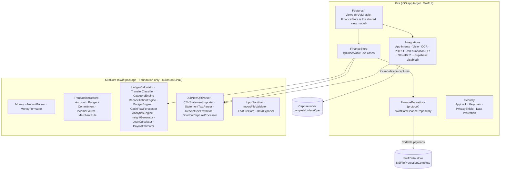
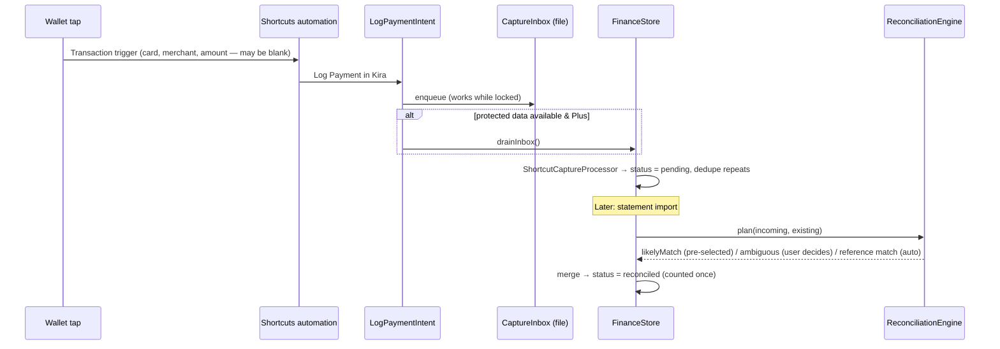
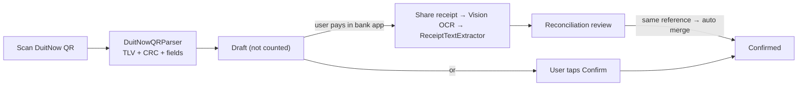

# Architecture

## Layers



**Why this split:** everything that decides money (parsing, classification, totals, forecasts) lives in a dependency-free package with 122 tests that run on any CI. The app layer is a thin shell of persistence, UI and Apple frameworks, which can only be validated in Xcode.

## Capture pipelines





## Key decisions

| Decision | Rationale |
|---|---|
| Money is `Int64` sen + ISO currency; user input with > 2 decimals is rejected, not rounded | No floating-point drift. Derived values (interest, %) round half-up explicitly |
| A transaction stores a **magnitude + direction + kind** | Kind (expense, transfer, creditCardRepayment, walletTopUp, refund, reversal, fee, debtRepayment, income) decides what counts as spending. Sign alone can't |
| Status lifecycle: draft → pending → confirmed → reconciled (+ superseded) | Drafts and superseded records never count. Pending counts by default but is labelled, and a policy can exclude it |
| SwiftData entities store Codable payloads + indexed columns | Domain types stay platform-free. Schema changes are Codable-compatible |
| `FinanceStore` holds an in-memory snapshot | Personal-scale data (thousands of rows) and instant derived figures. Engines are pure functions over arrays |
| Calendar pinned to Asia/Kuala_Lumpur | Month boundaries don't move when travelling or on UTC CI |
| Auto-merge only on identical reference or identical import fingerprint | Avoids silently deleting a genuine second purchase |
| Learned rules apply to future records only | Explicit user choices on existing records are never overwritten |
| Feature gating centralised in `FeatureGate` | Export/delete/history are hard-coded free. Tested |

## Directory map

```
Kira/
  project.yml                 XcodeGen spec (source of truth for the Xcode project)
  Packages/KiraCore/          Domain package + tests + synthetic fixtures
  Kira/Application            App entry, dependency container
  Kira/DesignSystem           Tokens (colour, type, radius, spacing), components
  Kira/Navigation             Tab structure
  Kira/Core/Persistence       SwiftData entities, repository
  Kira/Core/Security          App lock, Keychain
  Kira/Core/Services          FinanceStore, CaptureInbox
  Kira/Features/*             Home, Transactions, Capture, DuitNow, Imports, Reconciliation,
                              Accounts, Budgets, Analytics, CashFlow, Debt, Subscriptions,
                              Settings, Onboarding
  Kira/Integrations/*         Shortcuts, VisionOCR, PDF, QRScanning, StoreKit, Supabase, FinanceKit
  KiraTests/                  App integration tests (in-memory SwiftData)
  KiraUITests/                UI smoke tests (in-memory store via -uiTesting)
  supabase/migrations/        Optional sync schema with RLS (not deployed)
```

## Adding a new bank

1. Add an `ImportProfile` in `ImportProfiles.swift` with any extra header synonyms, the sign convention and summary-row markers.
2. Add a **synthetic** fixture that mirrors the layout and a test in `ImportTests.swift`.
3. Validate against a real redacted export, then set `layoutVerified: true`.

No core transaction logic changes are needed. Classification, categorisation, fingerprints and reconciliation are shared.
