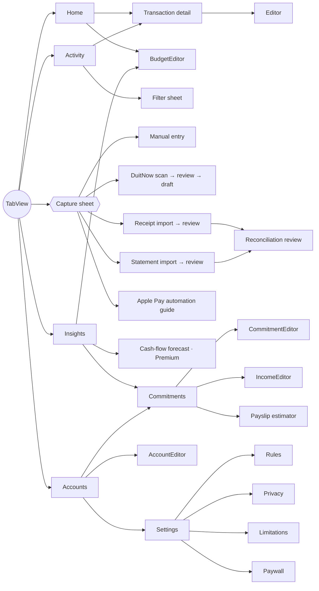

# Screen & navigation specification

Five tabs (`RootView`). **Capture** is a tab-bar button that opens a sheet (medium/large detents) and returns the user to where they were.

| Screen | Purpose | Empty state | Key states |
|---|---|---|---|
| Home | Month spending (hero), budget bar with pace marker, vs last month (same point), review banner, This month rows labelled Recorded / Scheduled / Estimate, insights carousel, latest 6 | "Start with one transaction" + Add | Pending count, over budget, forecast confidence notice |
| Activity | Day-grouped history, search, filters (date, account, category, source, status), "To review" segment, swipe Confirm/Delete, totals for the filtered view | Per segment | Draft strike-through, Pending pill, Matched seal |
| Transaction detail | Amount, status explanation, details, source & confidence, possible duplicates with "Same payment — merge", delete | Not found | Confirm disabled until the amount is known |
| Editor | Hero amount field, direction, merchant (auto-suggests category), type, category, date, account, channel, notes | — | Inline validation (> 2 decimals, zero) |
| Capture sheet | Manual · Scan QR · Receipt · Statement · Apple Pay automation | — | — |
| DuitNow flow | Camera / photo QR → merchant review, warnings, optional amount → draft | Camera denied explanation | CRC failure warning ("don't pay with it") |
| Receipt import | PhotosPicker → OCR → extracted fields with confidence → review | — | Failed receipts are blocked |
| Statement import | Profile + account → CSV/PDF → (password) → review | — | Free-tier remaining count; layout warnings |
| Reconciliation review | Counts (New / Matched / Already in Kira), skipped lines, "Check these" decisions, Save N | — | Ambiguous items require a choice |
| Insights | Period picker, budgets, 6-month trend (single accent series), ranked category bars, top merchants, patterns, plan-ahead links | "No data yet" | Gated links show the required plan |
| Cash flow | Safe to spend + per day, confidence label, dashed projection with buffer rule, breakdown, low-balance warning, assumptions | — | Low confidence explains why |
| Accounts | Grouped by type with "Confirmed x ago" balance freshness | "Add your accounts" | Stale balances in amber |
| Settings | Plan, app lock, capture, rules, export CSV/JSON, privacy, delete all (type DELETE) | — | — |

**Accessibility:** all amounts carry VoiceOver phrasing ("2,845 ringgit 60 sen"). Rows are combined accessibility elements. Status is never conveyed by colour alone. System fonts give Dynamic Type everywhere. Charts have accessibility labels/values. A UI test runs at AccessibilityXXXL.
