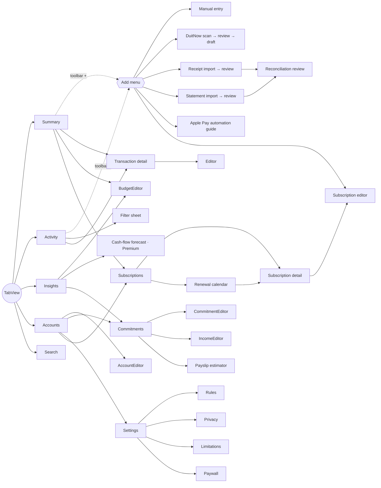

# Screen & navigation specification

Four navigation tabs plus a trailing **Search** tab (`RootView`). Adding is an *action*, so it is a standard **Add (+)** pull-down menu in the toolbar of Summary and Activity, not a tab (HIG › Tab bars). See [DESIGN.md](DESIGN.md).

| Screen | Purpose | Empty state | Key states |
|---|---|---|---|
| Summary | Large title "Summary" with greeting/date subtitle; month spending (hero), budget bar with pace marker, vs last month (same point), review banner, This month rows labelled Recorded / Scheduled / Estimate, insights carousel, latest 6 | "Start with one transaction" + Add | Pending count, over budget, forecast confidence notice |
| Activity | Day-grouped history, filters (date, account, category, source, status), "To review" segment, swipe Confirm/Delete, totals for the filtered view | Per segment | Draft strike-through, Pending pill, Matched seal |
| Transaction detail | Amount, status explanation, details, source & confidence, possible duplicates with "Same payment — merge", delete | Not found | Confirm disabled until the amount is known |
| Editor | Hero amount field, direction, merchant (auto-suggests category), type, category, date, account, channel, notes | — | Inline validation (> 2 decimals, zero) |
| Add menu (toolbar +) | Add Manually · Scan DuitNow QR (full-screen) · Import Receipt · Import Statement · Set Up Apple Pay Logging; each opens a sheet with a standard Close button | — | — |
| Search (tab) | Landing page with frequent merchants; search-as-you-type over merchant, description, notes, reference; scope bar All / Spending / Money In | Suggestions | Spent total for results |
| DuitNow flow | Camera / photo QR → merchant review, warnings, optional amount → draft | Camera denied explanation | CRC failure warning ("don't pay with it") |
| Receipt import | PhotosPicker → OCR → extracted fields with confidence → review | — | Failed receipts are blocked |
| Statement import | Profile + account → CSV/PDF → (password) → review | — | Free-tier remaining count; layout warnings |
| Reconciliation review | Counts (New / Matched / Already in Kira), skipped lines, "Check these" decisions, Save N | — | Ambiguous items require a choice |
| Insights | Period picker, budgets, 6-month trend (single accent series), ranked category bars, top merchants, patterns, plan-ahead links | "No data yet" | Gated links show the required plan |
| Cash flow | Safe to spend + per day, confidence label, dashed projection with buffer rule, breakdown, low-balance warning, assumptions | — | Low confidence explains why |
| Accounts | Grouped by type with "Confirmed x ago" balance freshness | "Add your accounts" | Stale balances in amber |
| Settings | Plan, app lock, capture, rules, export CSV/JSON, privacy, delete all (type DELETE) | — | — |

**Accessibility:** all amounts carry VoiceOver phrasing ("2,845 ringgit 60 sen"). Rows are combined accessibility elements. Status is never conveyed by colour alone. System fonts give Dynamic Type everywhere. Charts have accessibility labels/values. A UI test runs at AccessibilityXXXL.
| Subscriptions | Two tiles: per month (your share, N active) and due in 30 days (N upcoming bills); Spending Trends line chart of *recorded* charges with 3M/6M/1Y and a written summary; calendar button; Needs Attention (price changed, trial ending, no recent charge, duplicate); Active list sorted by Upcoming / cost / name with "Renews on <date>" and price + cycle; Paused & Cancelled; swipe to mark cancelled; "Found in Your Transactions" suggestions | ContentUnavailableView with Add; trend shows an explanation until charges are recorded | Trial pill, cancelled rows dimmed |
| Subscription detail | Icon, name, category chip, price + cycle, status pill with symbol; Renews on, Last billed, Total spent since start (recorded charges, or an estimate labelled as such); billing, per month/year, your share, paid from, reminder; Notes; Billing History; Update Price; Manage in App Store (Apple-billed); Mark Paused / Cancelled / Active; Edit and Delete (trash, confirmed) in the toolbar | "No charges found" explanation | Explains that Kira can't cancel with the provider |
| Renewal calendar | Monday-first month grid, service icons on renewal days (two + "+N"), today highlighted, previous/next month, month total cost; tap a day to list its renewals | "Nothing renews on this day" | Day cells are buttons with spoken weekday, date and services |
| Subscription editor | Service picker (29 Malaysian-available services + custom), price and currency, billing cycle, status and trial end, paid from, billed through Apple, family split, reminder, category, statement text, notes | — | Inline price validation |
