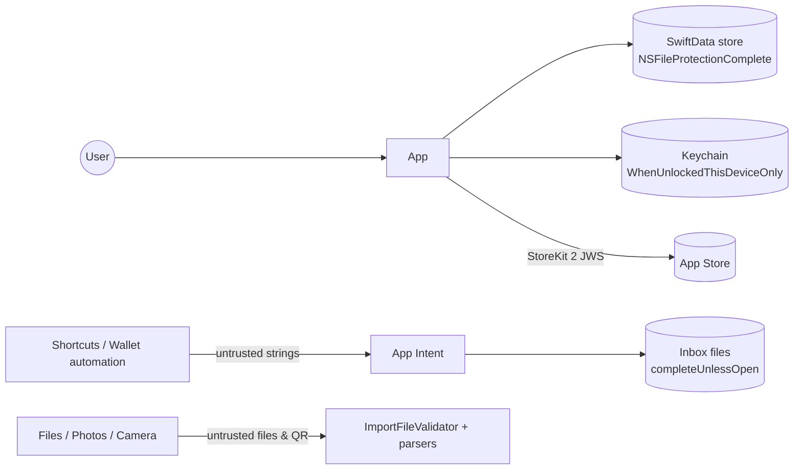

# Security: threat model & review checklist

Kira makes **no claim** of "bank-grade" security, certification or regulatory compliance. This document records the design and what still needs independent assessment.

## Assets
1. Transaction history, balances, loans and income (personal financial data, PDPA "personal data").
2. Receipt images and statements while they are being imported (transient).
3. Subscription entitlement (integrity).
4. Future: sync session tokens (Keychain).

## Trust boundaries & data flows

No other network calls. No third-party SDKs.

## STRIDE threats & mitigations

| Threat | Example | Mitigation | Where |
|---|---|---|---|
| **S**poofing | A malicious QR imitates a merchant | CRC validation; DuitNow AID shown; altered codes are blocked with "don't pay with it"; scanning never confirms payment | `DuitNowQRParser`, `DuitNowScanFlow` |
| **T**ampering | Crafted CSV with formula injection exported later | `InputSanitizer.csvSafeCell` on every exported cell | `DataExporter` |
| T | Renamed binary posing as CSV/PDF | Magic-byte checks, size limit (15 MB), page limit (30), NUL detection, XLSX/ZIP rejected | `ImportFileValidator`, `PDFTextExtractor` |
| T | Bidi/control characters spoofing merchant names | `cleanText` strips Cc/Cf scalars, collapses whitespace, caps length | `InputSanitizer` |
| T | Forged subscription | Only `VerificationResult.verified` transactions grant tiers; revocations and expiries honoured | `SubscriptionManager` |
| **R**epudiation | "I didn't export/delete my data" | Local audit log of export / app-lock changes (digits redacted) | `AuditEventEntity` |
| **I**nformation disclosure | Lost/stolen locked phone | Data Protection Complete on the store and directory; Keychain `WhenUnlockedThisDeviceOnly` | `PersistenceController`, `KeychainStore` |
| I | Unlocked phone handed to someone | Optional Face ID / passcode lock with 30 s grace | `AppLock` |
| I | App-switcher snapshot | Content blurred whenever the scene isn't active | `PrivacyShield` |
| I | Logs leaking account numbers | `os.Logger` with privacy annotations; `redactForLogging` masks digit runs ≥ 6; no amounts logged | various |
| I | Statement sent to AI services | No network AI. `CategorySuggestionProvider` has no shipped implementation; any future one requires opt-in consent | `CategoryEngine` |
| **D**enial of service | Huge/malicious file freezes the app | Size, row (20k) and page caps; QR length ≤ 512; TLV bounds checks | validators |
| **E**levation of privilege | Sync user reads another's data | (Future) RLS on every table, `force row level security`, no service-role key in the app, server-set `user_id` | `supabase/migrations/0001_init.sql` |

## OWASP MASVS v2 checklist (self-assessment — not an audit)

| Control group | Status |
|---|---|
| MASVS-STORAGE-1/2: sensitive data stored securely, no leakage | ✅ Data Protection Complete; nothing in UserDefaults except UI prefs; inbox files protected; no logs of amounts. ⚠️ SQLite free pages may retain deleted data until vacuum. Backlog: VACUUM after delete-all |
| MASVS-CRYPTO-1/2 | ✅ No custom crypto; relies on iOS Data Protection and Keychain. FNV-1a is used only for non-security fingerprints |
| MASVS-AUTH-1/2/3 | ✅ Local auth via LocalAuthentication with passcode fallback; enabling requires a successful auth. (Sync auth not implemented) |
| MASVS-NETWORK-1/2 | ✅ No custom networking. ATS defaults untouched. (Future sync: TLS only, consider pinning) |
| MASVS-PLATFORM-1/2/3 | ✅ App Intent inputs validated/sanitised. No custom URL schemes or WebViews. File importer uses security-scoped access |
| MASVS-CODE-1..4 | ✅ Input validation at every boundary, strict parsing, no dynamic code. ⚠️ Dependency scanning N/A (no third-party deps) |
| MASVS-RESILIENCE | Not targeted (no anti-tamper). Acceptable for a local-first finance tracker |
| MASVS-PRIVACY-1..4 | ✅ Minimal data, on-device processing, export + delete, privacy manifest declares no collection |

## Security testing performed
- Unit tests: sanitisation, CSV injection, file validation (empty, oversize, type mismatch, ZIP-as-CSV, unknown types), tampered QR (CRC), malformed TLV, duplicate tags, oversize QR, free-tier gating never blocks export/delete, data deletion (app test).
- **Still required:** device-level verification of file protection classes, a penetration test of the future sync backend, a jailbreak-device storage inspection and an independent MASVS review.

## Backend controls when sync is built (Premium)
RLS + forced RLS on every user table · anon key only, never service-role in the app · client-side AES-GCM encryption of payloads (server sees ciphertext) · refresh token in Keychain, rotation on use · rate limits at the gateway / Edge Functions (e.g. 60 writes/min/user) · server-side validation of record type and size (in schema CHECKs) · audit table · account deletion cascades.
